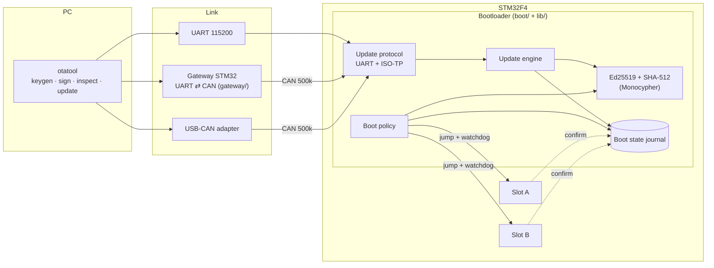
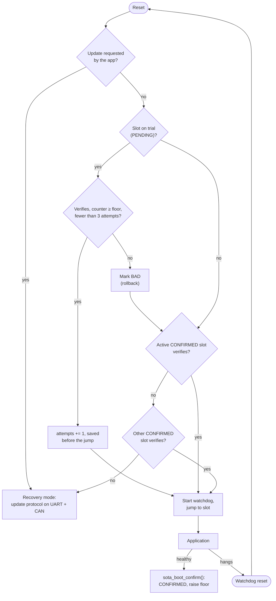
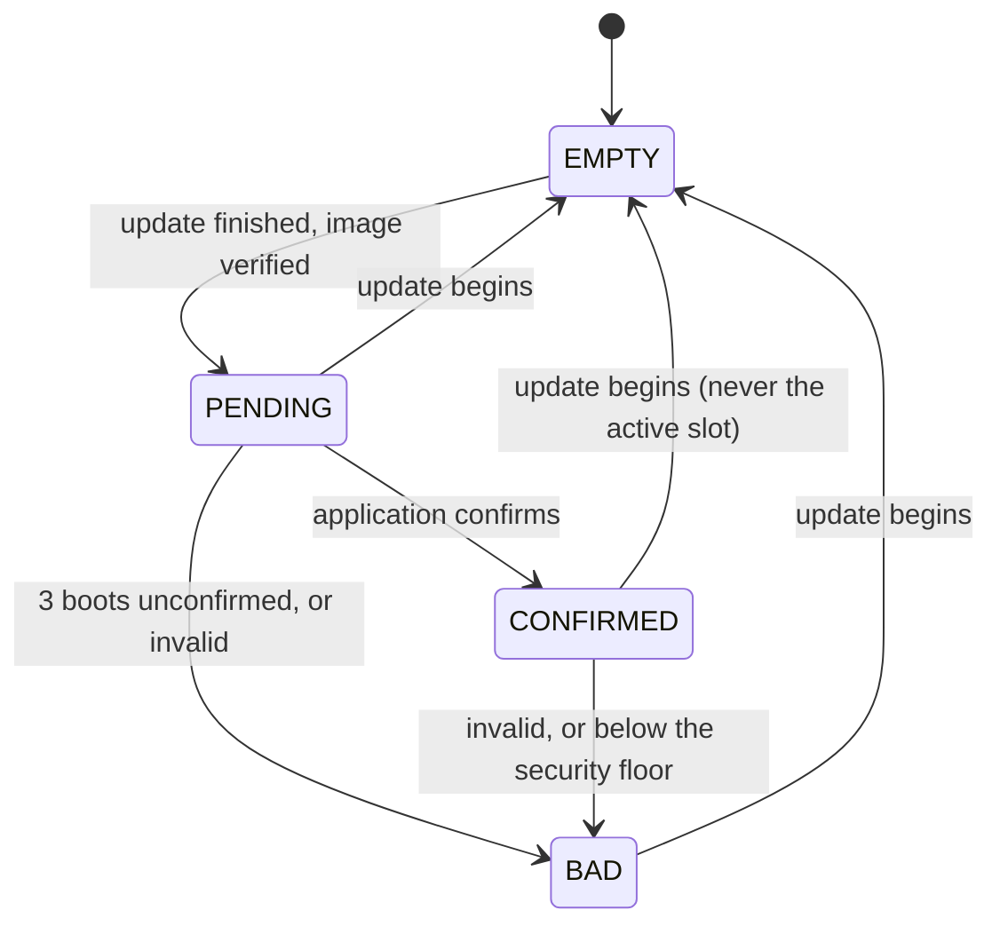
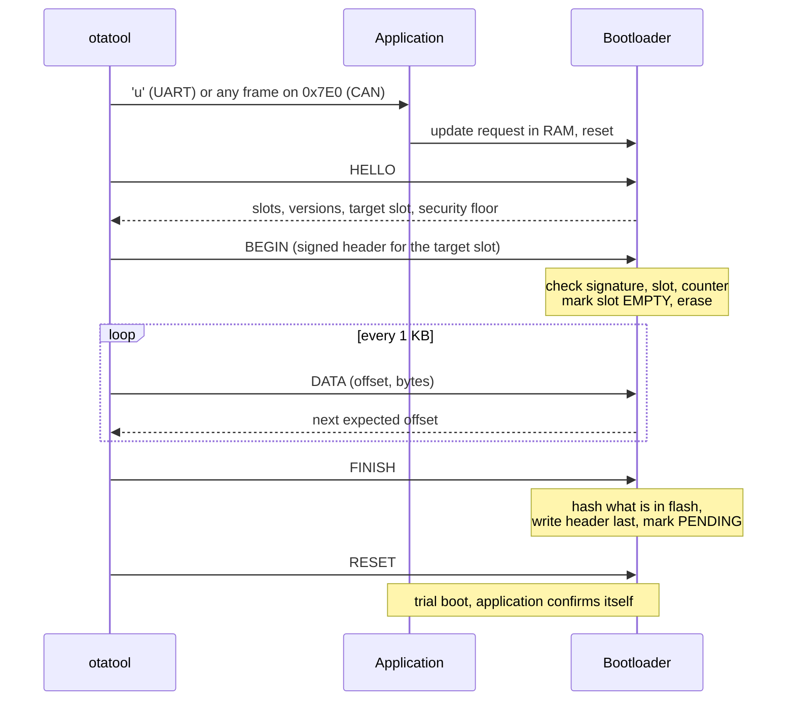

# STM32 Secure OTA Bootloader

[](https://github.com/FurkanKY/stm32-secure-ota/actions/workflows/ci.yml)

A secure bootloader for STM32F4, written from scratch in C: Ed25519-signed A/B images,
trial boot with watchdog rollback, anti-rollback, power-loss-safe updates over **UART**
and **CAN (ISO-TP)**, and a Python host tool. Bare metal, no vendor HAL, about 17 KB.

Everything is tested without hardware: the boot core runs as host unit tests (including
a sweep that cuts power during every flash operation of an update), and the real
firmware runs end to end in [Renode](https://renode.io), with a second simulated board
acting as a UART-CAN gateway.

<!-- Demo: replace with a GIF of an update over CAN and a rollback on real hardware. -->
> **Demo:** a recording on a Nucleo board is coming with the hardware milestone
> ([roadmap](docs/ROADMAP.md)). Until then, `python sim/smoke.py` boots the firmware in
> Renode and prints the console.

## Highlights

- **Signed images.** Ed25519 over a 512-byte header that carries the SHA-512 of the
  payload. Checked before anything is erased, after the image is written, and on every
  boot. ([image format](docs/image-format.md))
- **A/B slots, executed in place.** The running image is never the update target.
- **Trial boot and rollback.** A new image boots on trial with the watchdog running and
  must confirm itself; after three unconfirmed attempts the previous image comes back.
- **Anti-rollback.** A security counter, separate from the version number, locks out
  releases older than the last security fix.
- **Power-loss safe.** Boot state lives in an append-only, CRC-protected journal across
  two flash pages, and the image header is written last. A test cuts power at every one of
  the flash operations in an update cycle and checks that the device still boots.
- **One update protocol, two links.** UART and CAN (ISO 15765-2) carry the same
  resumable, CRC-checked frames ([protocol](docs/update-protocol.md)).
- **Host tool.** `otatool` generates keys, signs, inspects and updates over a serial port,
  a USB-CAN adapter (python-can) or a TCP socket into the simulator.

## Architecture



The code is split so that everything that decides *what* happens is portable and
host-tested, and only the thin port layer touches registers:

| Layer | Path | Contents |
|---|---|---|
| Boot core | `lib/` | image verification, boot state journal, boot policy, update engine, update protocol, ISO-TP |
| Port | `port/stm32f4/` | startup, flash, UART, bxCAN, IWDG, jump; register header written from RM0090 |
| Images | `boot/`, `app/`, `gateway/` | bootloader, demo application, UART-CAN gateway |
| Host | `tools/otatool/` | signing, image inspection, protocol client, transports |

## Memory map (STM32F407VG, 1 MB flash)

Generated from [`boards/stm32f407vg/layout.json`](boards/stm32f407vg/layout.json), which
also drives the linker scripts and `otatool`, so the three can never disagree.

| Address | Size | Sectors | Content |
|---|---|---|---|
| `0x0800_0000` | 32 KB | 0-1 | Bootloader |
| `0x0800_8000` | 2 × 16 KB | 2-3 | Boot state journal (ping-pong pages) |
| `0x0801_0000` | 64 KB | 4 | Reserved |
| `0x0802_0000` | 384 KB | 5-7 | Slot A: 512 B header, then the application (vector table at `+0x200`) |
| `0x0808_0000` | 384 KB | 8-10 | Slot B: same layout, application linked for this address |
| `0x080E_0000` | 128 KB | 11 | Unused |
| `0x2001_FFE0` | 32 B | RAM | Handoff block: boot info to the app, update request to the bootloader |

## Boot flow



Slot states as stored in the journal:



## Update flow



## Numbers

| What | Value | How it was measured |
|---|---|---|
| Bootloader flash | **17,696 B** of 32 KB (54 %) | `arm-none-eabi-size`, GCC 14.2, `-Os` |
| … of which Ed25519 + SHA-512 | ≈ 10.5 KB | linker map |
| Bootloader RAM | 4.9 KB static + 8 KB stack reserve | linker map |
| Demo application | 3,060 B | `arm-none-eabi-size` |
| Signature check (Ed25519) | ≈ 1.81 M instructions | instruction count in Renode |
| Payload hash (SHA-512) | ≈ 119 instructions per byte | instruction count in Renode, 3 / 68 / 265 KB images |
| Full verification of a 100 KB image | ≈ 14 M instructions: ~0.9 s at 16 MHz, ~85 ms at 168 MHz | from the two rows above, assuming ~1 cycle per instruction |
| Update time over UART and CAN | *pending* | needs hardware ([M7](docs/ROADMAP.md)) |

On hardware the bootloader prints the verification time in cycles (DWT counter) on every
boot, so the estimates above can be replaced by measurements as soon as it runs on a board.

## Getting started

Tool installation (Arm GCC, CMake, Ninja, Renode, Python) is in [docs/setup.md](docs/setup.md).

### Build and test

```bash
python -m venv .venv
.venv/Scripts/pip install -e "tools[test,can]"     # Linux/macOS: .venv/bin/pip
pytest tools                                       # host tool

cmake -S . -B build/host -G Ninja -DSOTA_HOST_TESTS=ON
cmake --build build/host
ctest --test-dir build/host --output-on-failure    # boot core, power-cut sweep

cmake -S . -B build/fw -G Ninja "-DCMAKE_TOOLCHAIN_FILE=cmake/arm-none-eabi.cmake"
cmake --build build/fw                             # bootloader, signed apps, gateway
pytest sim                                         # end to end in Renode
```

### Sign your own image

Link the application for one slot (see `app/CMakeLists.txt`), then:

```bash
otatool keygen my_key.pem                          # keep it secret; HSM/KMS in production
otatool sign app_b.bin -o app_b.signed.bin --key my_key.pem \
    --layout boards/stm32f407vg/layout.json --slot B \
    --version 1.2.0 --security-counter 3
otatool inspect app_b.signed.bin --key my_key.pem
```

Build the bootloader with the matching public key: `-DSOTA_SIGNING_KEY=my_key.pem`.

### Flash a board

> Not yet run on hardware; these are the commands the hardware milestone will verify.

On an STM32F4-Discovery (STM32F407VG), with the on-board ST-Link:

```bash
STM32_Programmer_CLI -c port=SWD -w build/fw/boot/sota_boot.bin 0x08000000 \
    -w build/fw/app/app_v1_a.signed.bin 0x08020000 -v -rst
# or: openocd -f board/stm32f4discovery.cfg -c "program build/fw/boot/sota_boot.elf verify reset exit"
```

Console and UART updates use USART2 on PA2 (TX) / PA3 (RX) at 115200 8N1 (a 3.3 V
USB-UART adapter on the Discovery; the ST-Link virtual COM port on Nucleo boards).
CAN1 is on PB8 (RX) / PB9 (TX) and needs a transceiver such as SN65HVD230.

### Update

```bash
# Serial port (or a UART-CAN gateway board)
otatool update --port COM5 --layout boards/stm32f407vg/layout.json \
    build/fw/app/app_v3_a.signed.bin build/fw/app/app_v2_b.signed.bin

# USB-CAN adapter
otatool update --port can:pcan:PCAN_USBBUS1 --layout boards/stm32f407vg/layout.json ...

# The simulator's UART
otatool update --port tcp:127.0.0.1:PORT ...
otatool info --port COM5                           # slots, versions, security floor
```

Given one image per slot, `otatool` sends the one built for the slot the device wants.

## Testing

| Level | Where | What it covers |
|---|---|---|
| Unit (C, host) | `test/`, 67 tests | verification against images signed by `otatool`, journal and page rollover, boot policy, update engine, protocol framing, ISO-TP flow control |
| Power-cut sweep | `test/test_powercut.c` | a full update cycle with power cut inside each of its flash operations in turn (271 cut points over three variants), torn writes and half-erased sectors included |
| Host tool | `tools/tests/`, 46 tests | image format, CLI, journal records, protocol client, ISO-TP over a python-can virtual bus |
| End to end | `sim/`, 20 scenarios | real firmware in Renode: rollback by watchdog, anti-rollback, forged and corrupted images, power loss mid-update, updates over UART and over CAN through a gateway board, the CLI |
| CI | `.github/workflows/ci.yml` | all of the above; unit tests with gcc and clang under ASan and UBSan; size report |

The fake flash in the unit tests behaves like ECC flash: it only programs erased,
8-byte-aligned words, so double programming or misaligned writes fail the test. The
tests have been checked against deliberately broken code (for example, booting a pending
image without verifying it, or marking a slot pending before writing it).

## Design decisions

- **Own bootloader instead of MCUboot.** MCUboot (with Zephyr) is the industry default
  and the right call for most products. Writing one shows the mechanisms MCUboot hides:
  journalled state, header-first verification, write ordering for power loss. The image
  format takes MCUboot's separate security counter, but uses one fixed, fully signed header
  instead of a TLV area, which keeps the parser trivial.
- **Execute in place, one build per slot.** No swap, no scratch area and no copy: an
  update only ever writes the inactive slot, and rollback is instant. The cost is that
  every release is linked twice; `otatool update` picks the right binary.
- **Journal instead of per-slot trailers.** Records are appended and never rewritten, which
  works on flash that can only program a word once (STM32G4/H7/L4 ECC flash) and makes
  "newest valid record wins" the only recovery rule.
- **Verify the header before erasing.** A forged header costs the attacker a rejected frame,
  not a wiped slot.
- **ISO-TP block size 3.** bxCAN buffers three received frames. Asking the sender for a
  flow control frame every three frames means a polled receiver cannot be overrun, which
  the simulator (it delivers frames instantly) exposed and a unit test now pins down.
- **No vendor HAL.** The port is about 700 lines, comments included, against a register
  header written from the reference manual, which keeps the bootloader small and its
  behaviour visible.

## Security

What is defended, how, and what is out of scope (debug port, encryption, fault injection):
[docs/threat-model.md](docs/threat-model.md).

How the features map to the EU Cyber Resilience Act's essential requirements (secure
updates, integrity, availability, vulnerability handling), including the gaps:
[docs/cyber-resilience-act.md](docs/cyber-resilience-act.md).

## Status

Done: image format and tool, boot core, STM32F4 bootloader and demo app, UART and CAN
updates, CI configuration, documentation. Next: running on a Nucleo-F446RE and replacing
the estimates above with measurements, then CAN FD on an STM32G4. Details in the
[roadmap](docs/ROADMAP.md).

## Repository layout

| Path | Contents |
|---|---|
| `app/` | Demo application, built per slot and in test variants |
| `boards/` | Flash layout per board (single source of truth) |
| `boot/` | The bootloader |
| `cmake/` | Arm toolchain file, layout code generation |
| `docs/` | Image format, update protocol, threat model, CRA notes, setup, roadmap |
| `gateway/` | UART ⇄ CAN gateway firmware for a second board |
| `keys/` | Public development key (never use in production) |
| `lib/` | Portable boot core |
| `port/` | Board support (bare-metal STM32F4) |
| `renode/` | Simulation platform and scripts |
| `sim/` | End-to-end tests in Renode (pytest) |
| `test/` | Host unit tests, fake flash with power-cut injection, test vectors |
| `third_party/` | Monocypher 4.0.2 (Ed25519, SHA-512), Unity 2.6.0 (unit tests) |
| `tools/` | `otatool`, the Python host tool |

## License

MIT, see [LICENSE](LICENSE). Third-party code keeps its own licence:
Monocypher (CC0-1.0 or BSD-2-Clause), Unity (MIT).
